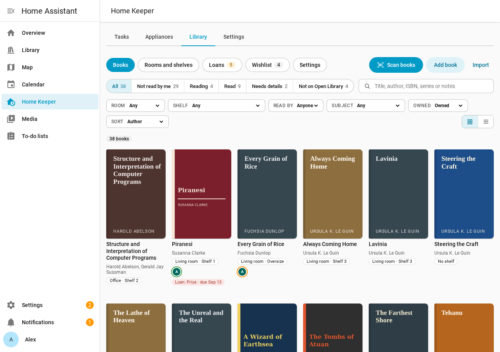

# Home Keeper Library

[![Integration Usage][usage-shield]][usage]
[![GitHub Downloads][downloads-shield]][releases]
[![GitHub Release][release-shield]][releases]
[![GitHub Release Date][release-date-shield]][releases]
[![GitHub Activity][commits-shield]][commits]
[![License][license-shield]](LICENSE)
[![hacs][hacs-shield]][hacs]
![Project Maintenance][maintenance-shield]
[![ko-fi][kofi-shield]][kofi]
[![HACS Validation][hacs-validation-shield]][hacs-validation]
[![HA Version][ha-version-shield]][ha-version]
[![Docs][docs-shield]][docs]

**Home Keeper Library requires [Home Keeper](https://github.com/prestomation/ha-home-keeper).
Install and set up Home Keeper first.**

Home Keeper Library is a Home Assistant integration for the books of a household. It
records the rooms, bookcases and shelves of the home, the books and their copies, the
reading status of each person, the loans and a wishlist. Admins manage it in a
**Library** tab of the Home Keeper panel. Every user gets a dashboard card, sensors and a
To read list.

> 📖 **Full documentation** (a browsable User Guide and Developer Guide) lives at
> **<https://prestomation.github.io/ha-home-keeper-library/>**. The site is generated from
> `docs/`, so the two never drift.

## Features

- Read the ISBN barcode of each book with the camera of a phone. Details and covers
  come from [Open Library](https://openlibrary.org).
- Find the shelf of each book in its room and bookcase.
- Keep a reading status, a rating, notes and a yearly goal for each person.
- Lend and borrow books, with a Home Keeper task on each due date.
- Send the wishlist books to buy to a to-do list of the person.
- Import a Goodreads or StoryGraph CSV file, and export to one.

## Install

1. Install and set up [Home Keeper](https://github.com/prestomation/ha-home-keeper#installation).
2. In [HACS](https://hacs.xyz/), add this repository as a custom repository, with the
   category **Integration**: `https://github.com/prestomation/ha-home-keeper-library`.
3. Install **Home Keeper Library** and restart Home Assistant.
4. Add the integration in **Settings → Devices & services → Add integration → Home
   Keeper Library**.

## Documentation

- [User Guide](https://prestomation.github.io/ha-home-keeper-library/docs/intro): every
  feature, with screenshots. The pages are written in [`docs/guide/`](docs/guide).
- [Developer Guide](https://prestomation.github.io/ha-home-keeper-library/developer/integrating):
  the services, the events and the API reference.
- [Release notes](https://prestomation.github.io/ha-home-keeper-library/docs/release-notes).

## Development

- Backend: `custom_components/home_keeper_library/`. The pure core imports no Home
  Assistant code.
- Panel frontend: `custom_components/home_keeper_library/frontend/`, built with
  TypeScript and Rollup.
- Tests: `pytest` in `tests/unit`, `tests/component` and `tests/integration`,
  Playwright in `tests/e2e`, and vitest.

See [AGENTS.md](AGENTS.md) for workflow, [RELEASE.md](RELEASE.md) for releases and
[Developing](docs/DEVELOPING.md) for the test commands and the CI guardrails.

## License

MIT. See [LICENSE](LICENSE).

[releases]: https://github.com/prestomation/ha-home-keeper-library/releases
[release-shield]: https://img.shields.io/github/release/prestomation/ha-home-keeper-library.svg?style=for-the-badge
[license-shield]: https://img.shields.io/github/license/prestomation/ha-home-keeper-library.svg?style=for-the-badge
[hacs-shield]: https://img.shields.io/badge/HACS-Custom-41BDF5.svg?style=for-the-badge
[hacs]: https://github.com/hacs/integration
[hacs-validation-shield]: https://github.com/prestomation/ha-home-keeper-library/actions/workflows/hacs.yml/badge.svg
[hacs-validation]: https://github.com/prestomation/ha-home-keeper-library/actions/workflows/hacs.yml
[usage-shield]: https://img.shields.io/badge/dynamic/json?color=41BDF5&logo=home-assistant&label=integration%20usage&suffix=%20installs&cacheSeconds=15600&url=https%3A%2F%2Fanalytics.home-assistant.io%2Fcustom_integrations.json&query=%24.home_keeper_library.total&style=for-the-badge
[usage]: https://analytics.home-assistant.io/
[downloads-shield]: https://img.shields.io/github/downloads/prestomation/ha-home-keeper-library/total.svg?style=for-the-badge
[release-date-shield]: https://img.shields.io/github/release-date/prestomation/ha-home-keeper-library?style=for-the-badge
[commits-shield]: https://img.shields.io/github/last-commit/prestomation/ha-home-keeper-library?style=for-the-badge
[commits]: https://github.com/prestomation/ha-home-keeper-library/commits/main
[maintenance-shield]: https://img.shields.io/badge/maintainer-%40prestomation-blue.svg?style=for-the-badge
[ha-version-shield]: https://img.shields.io/badge/Home%20Assistant-2025.7%2B-blue.svg?style=for-the-badge
[ha-version]: https://www.home-assistant.io/
[docs-shield]: https://img.shields.io/badge/docs-website-03a9f4.svg?style=for-the-badge
[docs]: https://prestomation.github.io/ha-home-keeper-library/
[kofi-shield]: https://img.shields.io/badge/Ko--fi-donate-FF5E5B?style=for-the-badge&logo=kofi&logoColor=white
[kofi]: https://ko-fi.com/prestomation
