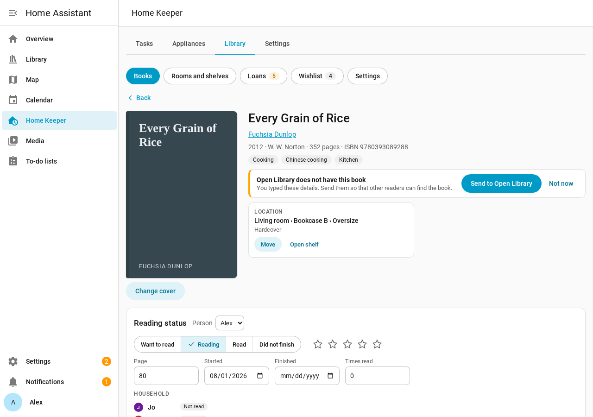
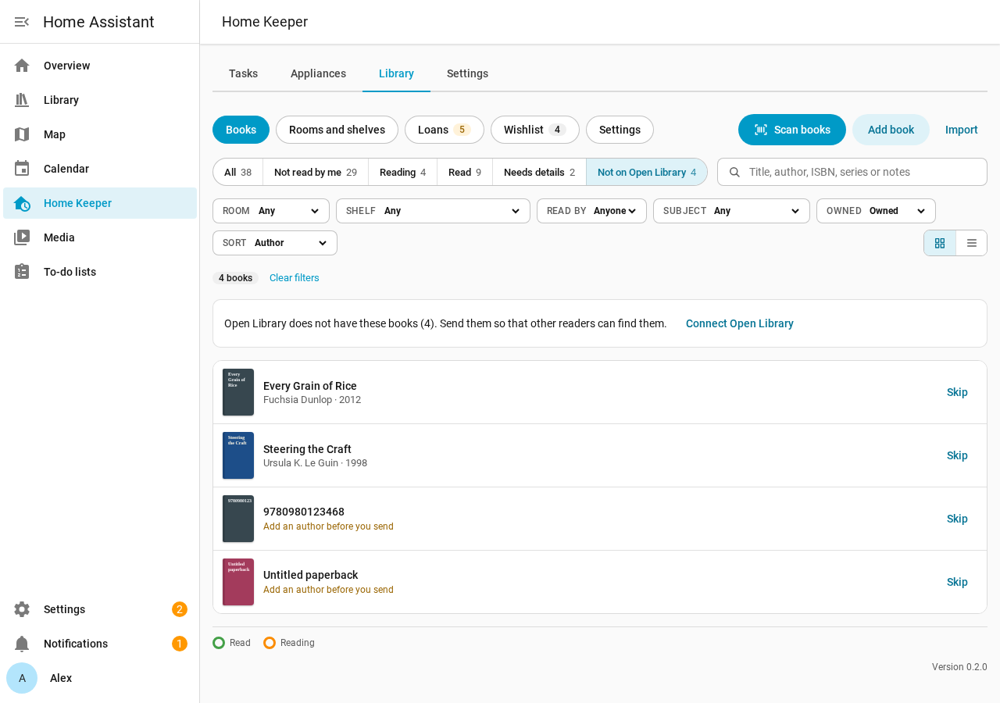
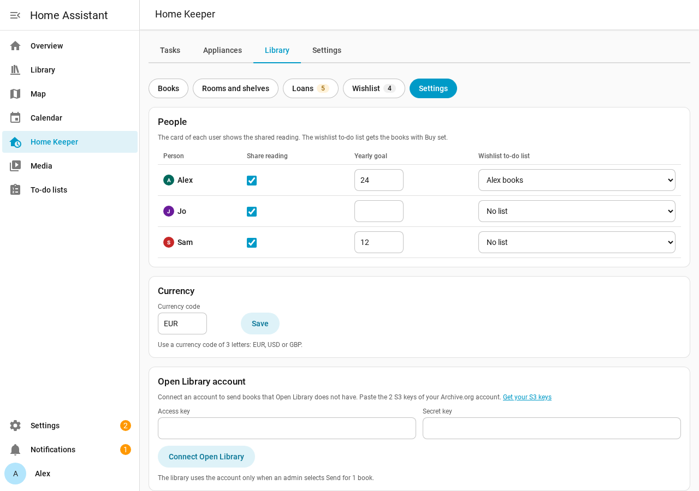
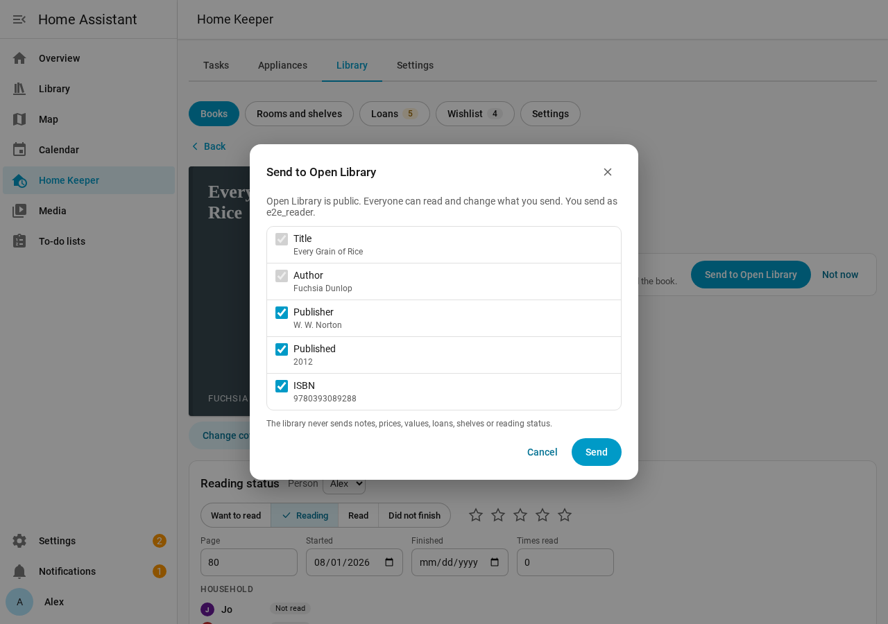
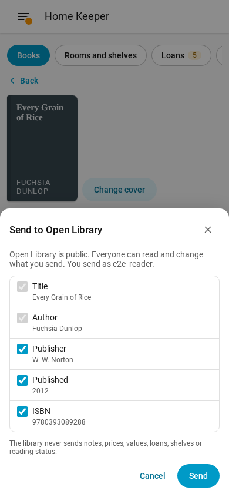

# Send books to Open Library

The library supports a send of a book to [Open Library](https://openlibrary.org) if
Open Library does not have the book. Open Library is the catalog that gives the library
its book details and covers. A book that you send is then in the catalog for other
readers. The library links your book to the new Open Library record.

Only an admin can connect an account and send books. Each send is for 1 book, and it
starts only when you select **Send**.

## Books that Open Library does not have

The library looks up each new book on Open Library. If the lookup finds no book, the
book gets the mark **Not on Open Library**. A lookup that fails because Open Library is
not available does not set this mark.

- On the **Books** page, select the **Not on Open Library** filter to see the list.
- On the page of 1 of these books, a banner shows **Open Library does not have this
  book**.
- After you add a book by ISBN, a message tells you if Open Library does not have it.

To remove a book from the list, select **Skip** in the list or **Not now** on the
banner. The book page still shows **Send to Open Library** in the actions at the
bottom.

## Connect an Open Library account

Open Library adds a book only for a signed-in account. The library signs in with the 2
S3 keys of your Archive.org account. An Open Library account is also an Archive.org
account.

1. Sign in at [archive.org](https://archive.org) with your Open Library account.
2. Open [archive.org/account/s3.php](https://archive.org/account/s3.php) and copy the
   access key and the secret key.
3. In the **Library** tab, open **Settings**.
4. In **Open Library account**, paste the 2 keys and select **Connect Open Library**.

The library checks the keys with 1 sign-in. Then the card shows **Connected as** and
the user name. You can also connect the account in the options of the integration, at
**Settings > Devices & services > Home Keeper Library > Configure**.

The keys stay in the config entry of Home Assistant. No reply, event or diagnostics
file shows them. To remove the keys, select **Disconnect**. If you revoke the keys on
Archive.org, a send fails and tells you to connect the account again.

## Send a book

1. Open the book, and select **Send to Open Library** on the banner.
2. Check the details in the dialog. The title and the first author always go.
3. Clear the publisher, the publish date or the ISBN if you do not want to send it.
4. If the book has a custom cover, select **Cover** to send your photo too.
5. Select **Send**.

The library never sends notes, prices, values, loans, shelves or reading status.
Open Library is public, so everyone can read and change what you send.

After the send, the dialog shows the key of the new Open Library edition. The library
links the book and fills its empty details from Open Library. Your details stay as
you typed them.

The "Add a book" form of Open Library takes only these 5 details. Select **Add more
details on Open Library** to add the subtitle, the pages, the language and the other
details on the edit page of the new record.

### If Open Library has the book

Before the send, the library looks up the ISBN again. Open Library also checks the
details when it gets them. If Open Library has the book, the dialog shows the
key of that edition.

1. Select **Compare** to open the edition on Open Library.
2. If it is your book, select **Link to** and the key. The library links your book to
   that edition.

Open Library can find more than 1 work that can be the book. Then it asks you to pick 1
on its website, so the send stops there. Add the book on the Open Library website.

## Rules for a send

- A book needs an author before you send it. The list shows **Add an author before you
  send** on a book with no author.
- If the cover upload fails, the book is still added. The dialog tells you to add the
  cover on the Open Library page.
- The library sends 1 book at a time. Open Library asks for a bot account for automatic
  or bulk edits.

## Phone

The banner, the list, the dialog and the account card work at phone width.

## Automations

The services `send_to_openlibrary`, `link_openlibrary`, `skip_openlibrary` and
`disconnect_openlibrary` do the same steps. They are admin-only. See
[Services and events](../automation/services.md).
