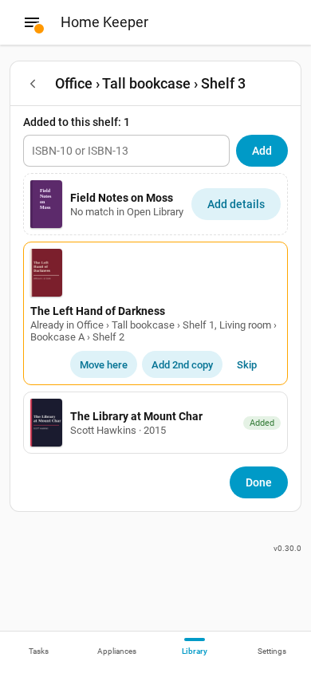
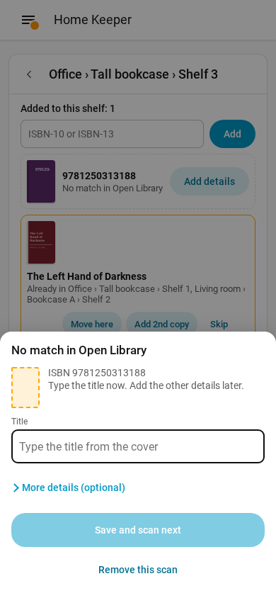
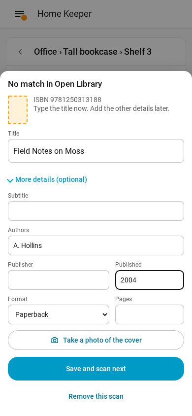
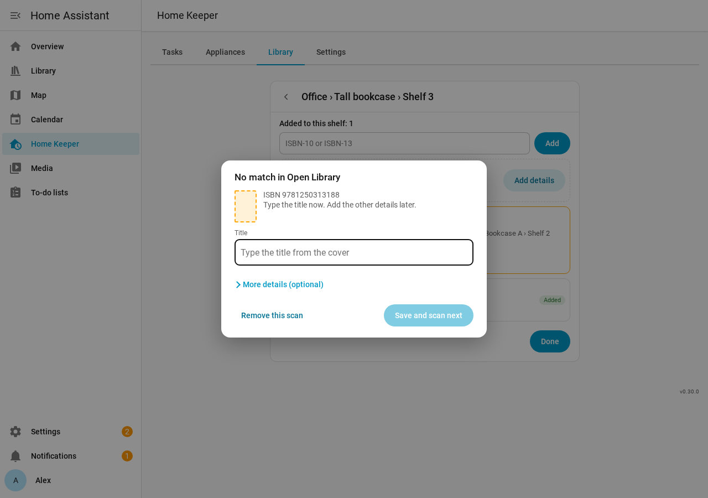
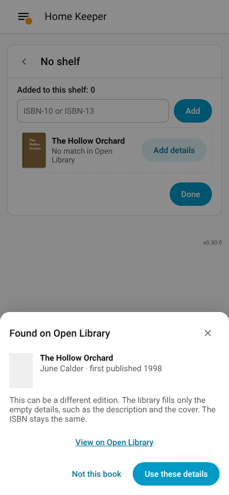
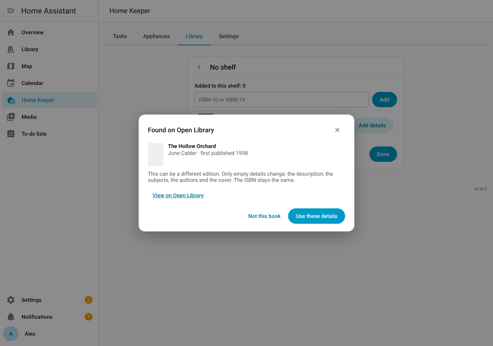
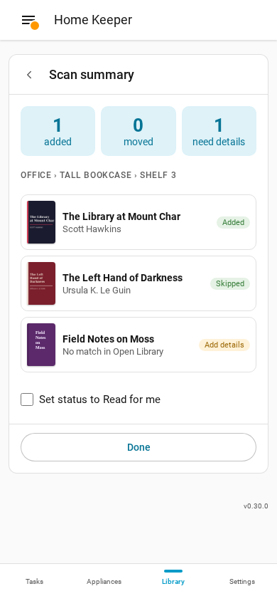
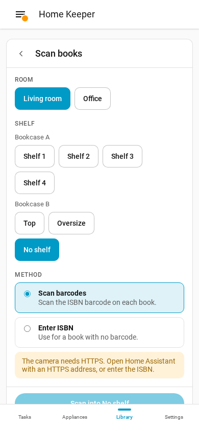
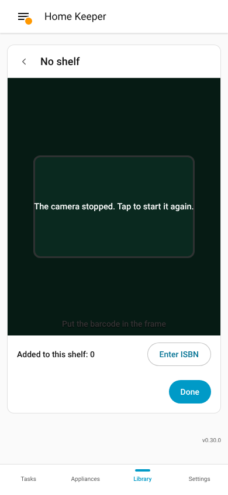
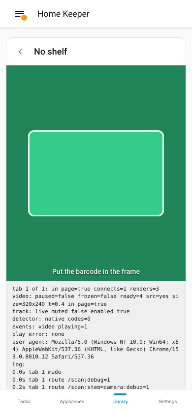

# Scan books

The library supports a scan of the ISBN barcode on the back of each book with the camera
of a phone. Each scan adds the book to the shelf that you select, with the details and
the cover from [Open Library](https://openlibrary.org). Use it to fill a shelf in 1 pass.

## Scan a shelf

1. Open the **Library** tab on a phone, and select **Scan books**. Or select **Scan** on a
   shelf in [Rooms and shelves](rooms-and-shelves.md).
2. Select the room and the shelf.
3. Select the method **Scan barcodes**, then select **Start scan** to open the camera.
4. Put the barcode of a book in the frame. The result shows under the camera.
5. Do step 4 again for each book on the shelf.
6. Select **Next shelf** to go on with the next shelf, or **Done** to see the summary.

If the light is low and the phone has a torch, select **Light**.

## Enter an ISBN

Use **Enter ISBN** for a book with no barcode, or on a computer with no camera.

1. Select the method **Enter ISBN**.
2. Type the ISBN-10 or the ISBN-13, and press Enter.

The library accepts an ISBN with or without hyphens. It checks the check digit, and shows
**This is not a valid ISBN.** for a typing error.

## Results

| Result | What it means |
|---|---|
| **Added** | The book and a copy on this shelf are in the library. |
| **Already in** *place* | The library has a copy of the book on another shelf. |
| **No match** | Open Library has no book with this ISBN. The scan asks for the title. |

For a book that is already in the library, select 1 of these:

- **Move here**: move the copy to this shelf.
- **Add 2nd copy**: add 1 more copy on this shelf.
- **Skip**: change nothing.

## Books with no match

If Open Library has no book with the ISBN, the scan stops and asks for the title. Then
you can find each of these books on the shelf later and add the other details.

1. Type the title from the cover of the book.
2. Select **Save and scan next**. The scan continues.

The camera reads no barcode until you select **Save and scan next** or **Remove this
scan**.

To add more details now, select **More details (optional)**. These fields show:

- Subtitle
- Authors
- Publisher
- Published
- Format
- Pages
- **Take a photo of the cover**

If you scanned the wrong barcode, select **Remove this scan**. The library deletes the
book and its copy.

The book keeps **Needs details**. To add the other details later, open the book and
select **Add details**.

If Open Library does not answer, the library saves the book with its ISBN and tries
again later. The book shows **Needs details** until the details arrive.

### Find the book by its title

Open Library often has the same book under a different ISBN, such as an older printing.
So when you save the title, the library looks for that title and author on Open Library.
A match shows in **Found on Open Library**, with the year of the first edition.

- Select **Use these details** if it is your book. The library fills only the empty
  details, such as the description and the cover. Your ISBN, publisher and page
  count do not change. A cover photo that you took stays.
- Select **Not this book** if it is a different book. Nothing changes.
- Select **View on Open Library** to compare the book on the Open Library website first.

The camera reads no barcode until you select 1 of the 2 buttons. An author makes the
search more accurate. To add an author, open **More details (optional)** before you save.

## Summary

**Done** shows the summary of the scan: the books that the scan added and moved, and the
books that need details. Select **Set status to Read for me** to set the status Read for
your person on each book that the scan added or moved.

## Borrowed books

On the **Loans** page, select **Scan borrowed books** to scan books that you borrow,
such as library books. Each scan adds a [loan](loans.md) with no copy.

## Camera and HTTPS

The browser gives the camera only to a page with an HTTPS address. On an `http://`
address, **Scan barcodes** shows the message **The camera needs HTTPS**. You cannot start
a camera scan there. Select **Enter ISBN** to add books without the camera.

To use the camera, open Home Assistant with an HTTPS address, such as Home Assistant
Cloud or a reverse proxy with a certificate. The Home Assistant phone app uses the
internal URL on your home network and the external URL away from home. If the camera
works only away from home, set the internal URL in the app to an HTTPS address too.

If the browser asks for the camera, allow it. If the browser cannot read barcodes, the
library loads a barcode reader of its own the first time.

## When the camera stops

If the camera picture stops during a scan, the camera shows **The camera stopped. Tap to
start it again.** Tap the picture to continue the scan. The results that you scanned stay.

In the Home Assistant app for Android, the camera can stop after each scan. To prevent
this, open **Settings** > **Companion app** in the app and turn on **Autoplay videos**.

If the camera stops again and again, open the camera debug view and send a screenshot of
it with your bug report. Add `;debug=1` to the end of the scan address:
`/home-keeper/library/scan;debug=1`. The Home Assistant app has no address bar, so put
this address in a link on a dashboard. A Markdown card can show the link:
`[Scan debug](/home-keeper/library/scan;debug=1)`. The debug view shows the camera state
and the last camera events under the picture.

